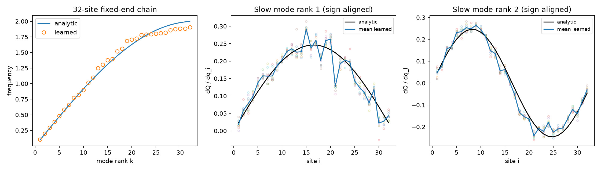
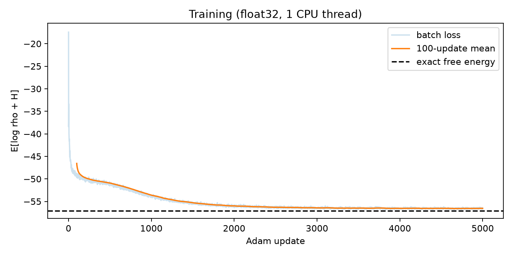
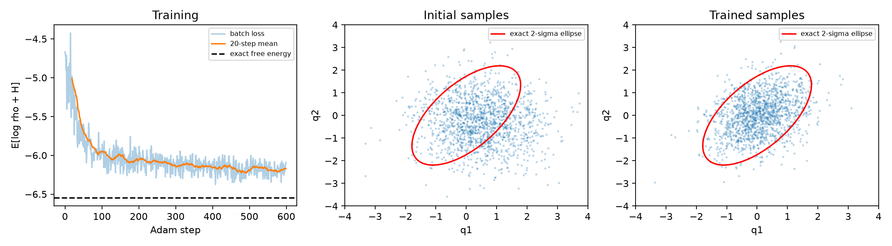

# Neural Canonical Transformation — Macでの再現実験

論文 **Neural Canonical Transformation with Symplectic Flows**（Physical Review X, 2020）の公式実装を使い、Apple M1のCPUで学習と評価を行った記録である。4粒子の動作確認に続き、論文Fig.3に対応する32粒子固定端harmonic chainを実行した。

**32粒子・5000更新で、周波数スペクトルの相対L2誤差4.25%、低速2モードのcosine一致度0.988／0.986を得た。** 厳密一致ではない。単一seedの再現記録であり、論文全体の再現・新規手法・性能保証を主張しない。

## 目的と論文の考え方

Hamilton系の座標と運動量を、構造を保つ正規変換で扱いやすい潜在変数へ写すことが目的である。通常のnormalizing flowが分布の可逆な変換を学ぶのに対し、この論文ではシンプレクティック条件を組み込むことで、学習した変数に力学的な意味を持たせる。

論文：[arXiv:1910.00024v3](https://arxiv.org/abs/1910.00024v3) ／ [PRX DOI](https://doi.org/10.1103/PhysRevX.10.021020)
公式実装：[li012589/neuralCT](https://github.com/li012589/neuralCT)
固定commit：`f5673f185a2b787f748cb72721eadebf907413a4`

公式sourceは改変せず、別途cloneする。本リポジトリは実験runner・評価・結果・説明を提供する。論文本文や著者の図は転載していない。

## 結果を見る

### 32粒子：論文Fig.3に対応する評価



左：解析的な周波数曲線と学習した32周波数。中央／右：周波数順の低速2モードの座標Jacobian。色付き点は生成10標本、青線は平均、黒線は解析正弦モードである。符号だけ整列し、振幅のフィッティングやモード順位の入替えはしていない。

| 主評価 | 結果 |
|---|---:|
| 周波数スペクトル全32点の相対L2誤差 | 4.2536% |
| 最低周波数：学習値／解析値 | 0.103531／0.095164（+8.79%） |
| 次低周波数：学習値／解析値 | 0.199288／0.190112（+4.83%） |
| 第1／第2低速モードの平均Jacobian cosine | 0.987669／0.986060 |
| 第1／第2の平均Jacobian相対L2誤差 | 15.67%／16.64% |
| 第1／第2の標本間Jacobian RMS標準偏差 | 0.013356／0.011733 |



batch loss、100更新移動平均、厳密自由エネルギーを示す。最後100更新の平均は−56.5373、厳密値は−57.0638で、終端はほぼ横ばいである。図と指標は最終5000更新のモデルによるもので、評価値でcheckpointを選び直していない。

### 4粒子：先に行った小規模動作確認



左は学習曲線、中央／右は同じ潜在標本から生成した初期／学習後のq1,q2各1500点。赤線は厳密共分散の2標準偏差楕円である（2次元95%領域という意味ではない）。この初回実験では周波数・正常モードは評価していない。

| 補助評価 | 4粒子：初期→最終 | 32粒子：初期→最終 |
|---|---:|---:|
| reverse KLのMC推定 | 2.040851 → 0.354309 | 42.307041 → 0.461187 |
| KL推定のMC標準誤差 | 0.036128 → 0.009158 | 0.173105 → 0.010545 |
| 全q,p共分散の相対Frobenius誤差 | 59.52% → 45.24% | 98.68% → 12.02% |
| 最初／最後の訓練batch loss | −4.667429／−6.089729 | −17.432642／−56.613995 |
| 厳密log Z | 6.546789309 | 57.063812344 |
| 学習loop実測 | 3.158秒 | 127.863秒 |

**4粒子と32粒子は非統制比較である。** 粒子数・容量・更新数・精度が同時に異なり、「更新数だけで45%が12%になった」とは言えない。異なる次元のKLも、そのまま性能順位としては比較しない。

## 論文・公式CLI・今回の設定の区別

| 項目 | 論文の確認範囲 | 4粒子動作確認 | 32粒子再実験 |
|---|---|---|---|
| n、境界、逆温度 | IV.B／Fig.3：32、固定端、β=1 | 4、固定端、β=1 | 論文に合わせ32、固定端、β=1 |
| 手法 | point transformation、学習可能な潜在周波数、変分目的 | 同じ種類 | 同じ種類 |
| point map数 | harmonic-chain固有の設定値は不明 | 1 | 公式CLI補完：1 |
| RNVP coupling層数／MLP幅 | 本文・付録でharmonic-chain固有値は不明 | 4／16 | 公式CLI補完：8／128 |
| MLP hidden層数・活性化 | 同上 | 2、Softplus | 公式実装：2、Softplus |
| optimizer／LR／weight decay | harmonic-chain固有値は不明 | Adam／.001／.001 | 公式train補完：Adam／.001／.001 |
| scheduler | harmonic-chain固有値は不明 | なし | 公式CLI既定と同じくなし |
| batch／更新数 | harmonic-chain固有値は不明 | 128／600 | 公式CLI補完：200／5000 |
| precision | harmonic-chain固有値は不明 | float64 | 公式CLI／notebook既定に合わせfloat32 |
| 主評価 | Fig.3：周波数・低速2モード | 未実施 | 実施 |

RNVP8層・幅128等は論文の指定だと偽らず、`variation.py`と`train/learn.py`の既定値を用いた補完である。公式notebookのパスにもl8/M2/H128があるが、配布モデルのHDF5を取得していないため著者の実学習条件の完全一致は確認していない。論文の分子実験のLR scheduler等をharmonic chainにも適用したとは推測しない。

## 式と実装の対応

実装は変数をx=(q,p)の順に持つ（論文の記号順は(p,q)）。固定端鎖は

$$H(q,p)=\frac12p^Tp+\frac12q^TLq,$$

Lの対角は2、隣接要素は−1。n+1本のばね、q0=q(n+1)=0に対応しzero modeはない。論文の印字ばね和は上限nで右端項が抜ける表記だが、公式実装は両端固定の説明と正常モード式に整合する。

| 数式・操作 | 公式実装 | 本実験での扱い |
|---|---|---|
| H=x^T A x、A=diag(L,I)/2 | `source/harmonicChain.py` | 公式クラスを直接使用 |
| Q=F(q)、P=Jacobianに対応する運動量変換（式2・3） | `flow/pointTransformation.py` | autograd VJP、create_graph=True |
| 可逆F、affine coupling | `flow/rnvp.py`、MLP | 公式の構造・活性化を利用 |
| 潜在K=Σ(Pk²+ωk²Qk²)/2（式4） | Gaussian＋`DiagScaling`＋`flowBuilder` | 座標の分散を学習、運動量分散1 |
| L=Eρ[logρ+βH]（式5） | `train.learn.reversedKLD` | 公式関数で学習 |
| density change of variables | `flow.Flow.sample` | logρ=log p0−logdet |

標準正規uからの生成は **G=S⁻¹D**。Dは座標のみexp(a)倍する潜在分布のスケーリング、Sは正規point mapである。Dの後の座標分散はexp(2a)なので、ω=exp(−a)。

**全サンプラーGは一般にシンプレクティックではない。** 正規写像はSで、Dはpriorの実装である。Sの位相空間logdetは座標・運動量側が打ち消して0になり、全体にはDのlogdet=Σaが残る。この区別は論文の「学習可能prior＋正規写像」に対応する。

公式notebookからの評価変更は、有効scale=`elements*fix`から周波数を求めること、周波数sortのindexをJacobianにも適用すること、固定符号[1,−1]でなく解析モードとの内積で符号だけ整列することである。無効な運動量scaleは周波数へ加えず、priorの逆scaleを含むfull forwardをモードJacobianに使わない。

## 指標の定義

評価用潜在標本は初期・最終それぞれ8192点で、同じ潜在点を共通使用する。学習とは独立なseed2026を使い、設定選択に用いていない。

- **reverse KL**：D_KL(ρ_model || π_target)。モデル生成標本x=G(u)で `log p0(u) − log|det DG| + H(x) + log Z` を平均。Gaussian近似KLではない。MC標準誤差は各標本値の標本標準偏差／√8192。学習lossは正規化定数log Zを加えない値である。
- **真の共分散・正規化**：β=1でΣ*=(2A)⁻¹、log Z=n log(2π)−½ log det(2A)。全q,pを含む2n×2n行列を対象に、`np.cov`で中心化・分母8191の標本共分散を算出。
- **共分散相対誤差**：‖Σhat−Σ*‖F／‖Σ*‖F。45%や12%は個々の変数が一律その割合ずれた意味ではない。有限標本誤差の反復推定・信頼区間は未実施。
- **周波数誤差**：昇順にした学習ωと解析ωk=2 sin(πk/(2n+2))の相対L2ノルム。低速2点は各解析値に対する符号付き相対誤差も記録。
- **モード比較**：生成10標本で、周波数順の2行の∂Qk/∂qiを計算。解析値sqrt(2/(n+1)) sin(ikπ/(n+1))へ符号だけ整列。平均Jacobianのcosine・相対L2、標本間のsiteごとの標準偏差をRMS集計。
- **往復誤差**：標準正規からfull inverse→full forwardの最大絶対誤差。4粒子16 probe、32粒子8 probe。
- **シンプレクティック条件**：J=[[0,I],[−I,0]]、autograd Jacobian Mに対しmax|MᵀJM−J|。4粒子8 probe、32粒子3 probeの局所検証。全空間の証明ではない。

| 幾何学検証 | 4粒子 float64 | 32粒子 float32 | 32粒子の同一係数float64 shadow |
|---|---:|---:|---:|
| 全サンプラー往復 | 6.66e−16 | 1.25e−6 | 2.66e−15 |
| 正規point mapの条件誤差 | 5.55e−16 | 2.98e−7 | 6.66e−16 |
| full samplerの条件残差 | 0.2228 | 8.6590 | 8.6590 |

shadowは再学習していない。float32と同じ係数をdouble化して、計算丸めの影響を見る補助評価である。32粒子の写像はfloat32、評価のエネルギー・KL集計はfloat64である。初回4粒子の精度説明の誤記も訂正する：sigmaはconstructor内でfloat32だが、sample前にモデルがdouble化されるため、**初回の潜在標本も生成時点からfloat64**だった。

Adamのweight_decay=.001は公式train既定を引き継いだ追加の正則化である。保存lossにはL2項を足していない。正則化が残差の主因とは確認していない。

## 実行環境・seed・負荷

実行日2026-10-26、MacBook Air／Apple M1／8 CPUコア／RAM8 GB／arm64／Darwin27.0.0。CPUのみ、Torch intra/inter-op各1 thread。Python3.12.14、Torch2.14.1、NumPy2.5.4、Matplotlib3.11.2、h5py3.16.0。全依存版は[requirements-lock.txt](requirements-lock.txt)に固定。

各実験の初期化・mask・NumPy seed42、訓練seed43、評価seed2026。異なる設定間で同一の乱数系列や初期モデルになることは意味しない。32粒子は最初100更新の2.537秒・最大RSS342 MiBから5000更新を約127秒と推定して継続し、実測127.863秒・最大RSS363 MiBだった。Mac全体のメモリ使用量ではない。時間はimport・初回font cache・描画等を含まない学習loopである。

## 再現手順

GitとPython3.12が必要である。Apple Silicon Macでの手順である。他OSでは固定版のwheel提供状況や数値が異なる可能性がある。

```sh
git clone https://github.com/youhei-nakano/neural-canonical-transformation-reproduction.git
cd neural-canonical-transformation-reproduction
python3.12 -m venv .venv
.venv/bin/python -m pip install --only-binary=:all: -r requirements-lock.txt
.venv/bin/python scripts/setup_upstream.py
```

setupは公式repoをvendor/neuralCTへcloneし、commitを固定・確認する。既存checkoutのcommitが違う／変更がある場合は書き換えず停止する。ダウンロードはsourceと依存のみで、大きなデータや事前学習モデルを取得しない。今回の元実験では専用環境の構築後、32粒子実行の追加ダウンロードはなかった。

4粒子：

```sh
OPENBLAS_NUM_THREADS=1 OMP_NUM_THREADS=1 .venv/bin/python experiments/harmonic4/run.py
```

32粒子：まず100更新を計測し、そのcheckpointを継続して総計5000更新にする。

```sh
OPENBLAS_NUM_THREADS=1 OMP_NUM_THREADS=1 .venv/bin/python experiments/harmonic32/run.py pilot
OPENBLAS_NUM_THREADS=1 OMP_NUM_THREADS=1 .venv/bin/python experiments/harmonic32/run.py train
OPENBLAS_NUM_THREADS=1 OMP_NUM_THREADS=1 .venv/bin/python experiments/harmonic32/run.py evaluate
```

新しい出力先はruns/harmonic4、runs/harmonic32。公開済みresults/は上書きしない。既存4粒子結果や完了済みtrainの再実行は停止する。別実験では環境変数`NEURALCT_RUN_DIR`で空の出力フォルダを指定できる。別の既存公式checkoutを使う場合は`NEURALCT_UPSTREAM`を指定し、同じcommitであることを確認する。32粒子はmodel・Adam・RNGを保存して再開する。evaluateのみ再実行するとそのrun内の評価物を置換する。

checkpointはGitに含めない。したがって新規cloneからevaluateだけを実行するには先にtrainが必要である。小さな数値結果・CSV・PNGは学習なしで閲覧できる。

## 監査と再実行検証

- [監査記録](docs/comparison_audit.md)：論文の節・式・ページ、公式commitのファイル・行を比較。初回4粒子時点の文書であり、当時の「未実行」と現在の32粒子結果は区別する。
- [公開用変更の説明](docs/PACKAGING.md)：元実験との対応、コードのポータブル化、含めないファイル。
- [公開前検証](docs/VALIDATION.md)：構文・配置・成果物・再評価・公開対象チェック。

point transformation一般＋学習可能座標分散priorは、鎖を直交正常モードへ写す解析的構成を持つ。ただし今回の有限RNVP構成の表現可能性や最適化の難しさを個別に証明・切り分けたわけではない。「600回だから失敗」「5000回なら必ず成功」とは結論しない。

## 保存物と限界

```text
experiments/harmonic4/run.py     4粒子学習・評価runner
experiments/harmonic32/run.py    32粒子pilot／train／evaluate
results/harmonic4/              metrics・loss・比較PNG
results/harmonic32/             metrics・全5000loss・周波数CSV・PNG・設定・計測
scripts/setup_upstream.py       上流commit固定取得
docs/                          監査・整理方針・検証
```

venv、上流sourceの重複コピー、checkpoint、標本NPZ、キャッシュ、個人絶対パス、他プロジェクト資料は公開対象から除外した。元のcheckpointや標本はローカルに保全している。追加の公開が必要な場合は、重みと必要性を個別に確認できる。

単一seed、harmonic chainの2設定のみである。論文の32粒子で示された傾向へ近づいた一方、低速モードの約16%のJacobian誤差、スペクトルの系統的なずれ、非ゼロKLが残る。seed間再現性、長期Hamilton軌道、分子・MNIST・Ringworld、大規模モデルの性能は未検証である。論文未記載の設定を公式既定で補完しており、著者の全実行条件が一致したとは保証しない。

## ライセンス・引用

コードは[Apache-2.0](LICENSE)。公式構造を参考にしたrunnerには変更と出典を記載し、[NOTICE](NOTICE)で上流を明示する。公式sourceは別途cloneし、そのライセンスを保持する。このリポジトリは著者の公式配布物ではない。掲載PNGは本実験で生成した。論文本文・原図・外部datasetは配布しない。

利用時は原論文を引用する。

```bibtex
@article{Li2020NeuralCanonical,
  author = {Li, Shuo-Hui and Dong, Chen-Xiao and Zhang, Linfeng and Wang, Lei},
  title = {Neural Canonical Transformation with Symplectic Flows},
  journal = {Physical Review X},
  volume = {10},
  pages = {021020},
  year = {2020},
  doi = {10.1103/PhysRevX.10.021020},
  eprint = {1910.00024},
  archivePrefix = {arXiv}
}
```
